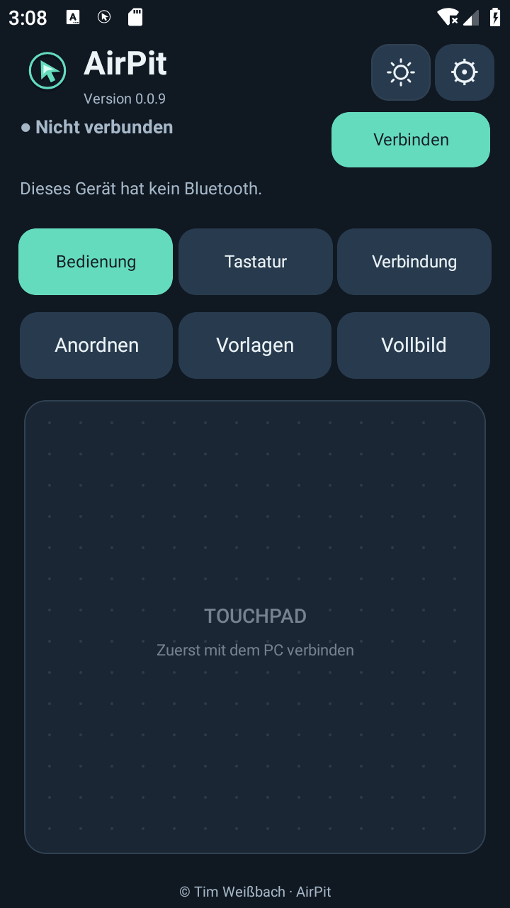
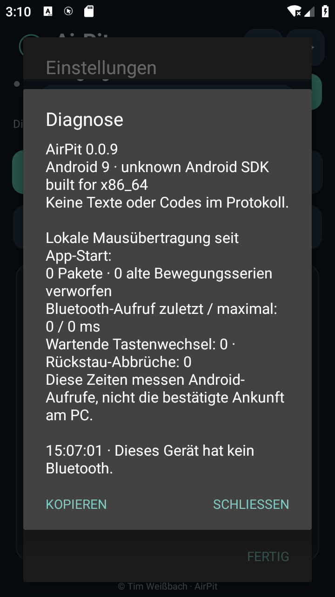

# AirPit 0.0.9

[Projektseite der Pit-Apps](https://wohnpit.extraordinarygrove.chatgpt.site/airpit/) · [WohnPit – Energie, Gas und Wasser](https://github.com/Tim-Gurke/WohnPit)

[Download](https://github.com/Tim-Gurke/AirPit/releases/latest) · [Anleitung](docs/ANLEITUNG.md) · [Versionshistorie](docs/VERSIONSHISTORIE.md) · [Prüfbericht](docs/qa/0.0.9.md)

Dein Android-Handy als **Bluetooth-Air-Maus, Touchpad und Tastatur für Windows**, mit frei anpassbarer Bedienfläche im Stil der Pit-Apps.

**[Android-APK herunterladen](https://github.com/Tim-Gurke/AirPit/releases/download/v0.0.9/AirPit-v0.0.9.apk)** · **[Optionaler Windows-Helfer für Gboard-Emojis](https://github.com/Tim-Gurke/AirPit/releases/download/v0.0.9/AirPit-Unicode-Windows.zip)** · [Änderungen und Testhinweise](docs/releases/0.0.9.md)

| Bedienfläche | Diagnose der Mausübertragung |
|---|---|
|  |  |

Aktuelle Aufnahmen der signierten App im Android-9-Emulator. Dort ist kein Bluetooth-Gerät vorhanden; die Bilder belegen die Oberfläche, keine echte PC-Verbindung.

## Direktere Mausbewegung

0.0.9 behebt Ursachen für nachlaufende Bewegungen bei Touchpad und Gyro: Der Maussender wartet nach jedem abgeschlossenen Bluetooth-Aufruf, statt versäumte Timeraufrufe nachzuholen. Kurze aktuelle Bewegungsabschnitte werden zusammengefasst; veraltete Bewegungen und abgeschnittene große Touchpad-Deltas werden nicht später nachgesendet. Im Leerlauf läuft kein Maus-Sendetimer. Tastendruck und Loslassen bleiben geordnet; überalterte Klickfolgen beenden die Sitzung.

Die Gyro-Verarbeitung hat einen eigenen Sensor-Thread, verwirft alte Sensordaten und nutzt kürzere Glättungszeiten. Gespeicherte Reglerwerte bleiben erhalten; derselbe Glättungswert reagiert jetzt direkter. Unter **Einstellungen → Diagnose ohne Textinhalte** stehen Paketanzahl, verworfene alte Bewegungsabschnitte und Dauer der Android-Bluetooth-Aufrufe. Diese Zeiten bestätigen keine Ankunft am PC.

Automatische Tests prüfen langsame Transportaufrufe bis 250 ms, Richtungswechsel und Loslassen. Die tatsächliche Latenz am S10 und Windows-PC muss weiterhin im Betrieb geprüft werden. [Prüfbericht und Grenzen](docs/qa/0.0.9.md).

## Einstellungen sichern und wiederherstellen

Unter **Einstellungen → Sicherung exportieren** eine `.airpit`-Datei speichern. **Sicherung importieren** öffnet die Android-Dateiauswahl und zeigt vor der Übernahme Design, Darstellungsgröße, Touchpad- und Gyro-Einstellungen sowie die enthaltenen Anordnungen für Seiten und Ausrichtungen. **Abbrechen** übernimmt nichts; erst **Übernehmen** speichert den geprüften Inhalt.

Gesichert werden gespeicherte Positionen, Größen und Sichtbarkeit aller einzelnen Kacheln, einschließlich Touchpad und Vollbild. Enthaltene Anordnungen ersetzen den jeweiligen gespeicherten Stand; andere bleiben erhalten. Bei einer anderen Bildschirmbreite wird die Anordnung wie bisher angepasst und ohne Überlappungen eingebunden. Offene Anordnungsentwürfe zuerst speichern oder verwerfen. Die Sicherungsdaten werden vor der Dateiauswahl vorbereitet. Ältere, von AirPit noch lesbare Layoutstände werden nur in der Sicherung normalisiert; die gespeicherten Originale bleiben erhalten.

Bluetooth-Kopplungen, PC-Adressen, Codes, Texte und die gerätebezogene Display-aus-Freigabe bleiben auf dem jeweiligen Handy. Fehlerhafte, unvollständige oder nicht unterstützte Dateien werden vollständig abgewiesen. Die Datei lässt sich auf ein zweites Handy übertragen und dort ab AirPit 0.0.7 importieren. [Schritt-für-Schritt-Anleitung](docs/ANLEITUNG.md#sicherung-exportieren-und-importieren).

## Mit Windows verbinden

1. APK auf dem S10 installieren; 0.0.9 lässt sich mit derselben Signierung über 0.0.8 und frühere AirPit-Versionen installieren. Die vorhandene App behalten.
2. Oben **Verbinden** antippen und Bluetooth bzw. „Geräte in der Nähe“ erlauben.
3. Bei der ersten Einrichtung unter **Verbindung → Für PC sichtbar** die Sichtbarkeit bestätigen.
4. In Windows unter **Bluetooth-Gerät hinzufügen** das Handy auswählen und die Kopplung bestätigen. Windows kann den normalen Bluetooth-Namen des S10 anzeigen.
5. Den PC einmal in AirPit auswählen. Danach verbindet die Taste oben den zuletzt verwendeten PC erneut.

Eine bestehende Bluetooth-Kopplung bleibt gespeichert. Der sichtbare Android-Dienst hält die Verbindung auch beim Wechsel in eine andere App. Die Steuerung pausiert dabei und lässt Tasten los. Über die Benachrichtigung lässt sich die Steuerung stoppen oder der Dienst beenden.

Android 9 oder neuer; die ROM muss Bluetooth-HID als Eingabegerät unterstützen. Keine Root-Rechte. Die echte Bluetooth-Verbindung, Latenz und das Verhalten der S10-ROM benötigen weiterhin einen Gerätetest.

## Maus und Bedienfläche

| Funktion | Bedienung |
|---|---|
| Air-Maus | Handy leicht drehen oder neigen; über die Air-Maus-Kachel ein-/ausschalten |
| Bewegungsachsen | Unter Einstellungen links/rechts und hoch/runter frei zuordnen oder mit „Achsen tauschen“ wechseln |
| Kalibrieren | Etwa eine Sekunde stillhalten |
| Umgreifen | Taste gedrückt halten, Handy neu ausrichten, loslassen |
| Touchpad | Ein Finger bewegt; tippen klickt links; zwei Finger scrollen oder tippen kurz für Rechtsklick |
| Touchpad-Geschwindigkeit | Unter Einstellungen von 25 bis 300 % wählen; 100 % entspricht dem bisherigen Tempo |
| Maustasten | Gedrückt halten oder mit „Ziehen“ die linke Taste einrasten lassen |
| Scrollen | Mit zwei Fingern oder den Scrolltasten, auch länger gedrückt |
| Vollbild | Große Touchpad-Fläche mit Maus-/Scrolltasten und Verbindungstaste |
| Anordnen | Einzelne Klickflächen am feinen Raster ausrichten; beim Einfügen rücken Nachbarn nach unten |
| Größe und Position | Ecke unten rechts ziehen oder Element antippen; Größenregler und genaue Zahlen nutzen |
| Elemente | Im Bearbeitungsmodus jede einzelne Fläche aus-/einblenden |
| Speichern & fertig | Alle Entwürfe der laufenden Bearbeitung übernehmen |
| Änderungen verwerfen | Gespeicherte Positionen, Größen und Sichtbarkeit wiederherstellen |
| Vorlagen | Großes Touchpad, Air-Maus, Kompakt, Maus und Text oder Standard |

Hoch- und Querformat sowie Bedienung, Tastatur, Verbindung und Vollbild besitzen eigene gespeicherte Anordnungen. Jede Klickfläche ist unabhängig; es gibt keine Bindung an feste Zeilen oder Gruppen. Auch Touchpad, Texteingabe, Hinweise und Kopfzeile sind Teil derselben frei nutzbaren Fläche. Am Rand wird beim Ziehen weitergescrollt. Die Touchpad-Höhe wird unabhängig von der Darstellungsgröße eingestellt.

Der Anordnungsmodus übernimmt die Rasterabstufungen und den Größen-Griff von Watt’n’Pit: 24 horizontale Schritte und halbe Zeilen. Eine Kachel direkt ziehen, um sie gerade auszurichten; die Ecke unten rechts ziehen, um sie zu vergrößern oder zu verkleinern. Beim Antippen bieten Größenregler und genaue Zahlen dieselben Änderungen an. Die bisherigen 4-dp-Schritte werden beim Bearbeiten durch dieses gröbere Raster ersetzt. Gespeicherte Positionen bleiben bis zur eigenen Bearbeitung erhalten. Reicht ein Zwischenraum nicht aus, rücken betroffene Nachbarn nach unten und schaffen Platz – bei Bedarf über mehrere Reihen. Unbetroffene Spalten behalten ihre Position. Es entstehen keine Überlappungen.

Die Vorschau startet bei jeder Bewegung von der ursprünglichen Anordnung des Ziehvorgangs. Beim Wegziehen rücken Nachbarn deshalb wieder zurück. Ein Abbruch stellt alle vorherigen Positionen wieder her. Beim Wiedereinblenden und beim Ändern der Position oder Größe kann ebenfalls Platz geschaffen werden. Vorhandene gespeicherte Anordnungen werden beim Öffnen nicht automatisch neu ausgerichtet. Ein-/ausblenden und Vorlagen ändern nur den Entwurf. Erst **Speichern & fertig** übernimmt die gesamte laufende Bearbeitung und bestätigt **Anordnung gespeichert**. **Änderungen verwerfen** stellt den gespeicherten Stand wieder her. Bei Zurück mit offenen Änderungen stehen **Speichern**, **Verwerfen** und **Weiter bearbeiten** zur Auswahl. Entwürfe bleiben beim Drehen des Handys und beim Wechsel der bearbeiteten Seite erhalten.

Unter **Einstellungen**: Darstellungsgröße **50–150 %**, Rückstellung auf 100 %, Touchpad-Geschwindigkeit (25–300 %), Air-Maus-Empfindlichkeit, Glättung, Zitterfilter, Bewegungsachsen, Richtungsumkehr und ein-/ausblendbare Erklärungen.

Unter **Einstellungen → Bewegungsachsen → Links / rechts** kann **Seitlich neigen / schwenken** gewählt werden: die linke oder rechte Handykante absenken. Hoch/runter bleibt auf Vor-/Zurückneigen; beide Richtungen lassen sich unabhängig zuordnen und umkehren. Die Zuordnung wird gespeichert und folgt der Bildschirmausrichtung. Die bisherige Bedienung bleibt beim Update voreingestellt.

Unter **Einstellungen → Touchpad-Geschwindigkeit** lässt sich die Ein-Finger-Zeigerbewegung unabhängig von der Gyro-Air-Maus einstellen. **100 %** ist das bisherige Tempo, **25 %** langsamer und **300 %** schneller. **Touchpad auf 100 %** stellt den Standard wieder her. Der Wert bleibt beim Drehen, im Vollbild und nach dem erneuten Öffnen der App erhalten.

## Bei ausgeschaltetem S10-Display

Unter **Einstellungen → Bei Display aus weitersteuern** ausdrücklich aktivieren und eine Air-Maus-Sitzung starten. Die Android-Benachrichtigung mit Stopptaste muss erlaubt sein. Die Bewegungssensoren arbeiten dann bei ausgeschaltetem Bildschirm weiter; eine partielle CPU-Wachhaltung ist auf diesen aktiven Modus beschränkt.

Beim normalen App-Wechsel bleibt Bluetooth verbunden, die Bedienung wird pausiert. Bei Display aus kann nur eine zuvor bewusst gestartete Air-Maus weiterlaufen. Über die Benachrichtigung **Steuerung stoppen** bzw. **Beenden** wählen.

## Gboard und Text

Mit der gewohnten Bildschirmtastatur tippen, korrigieren oder diktieren und anschließend **Text an PC senden**. Die Darstellung und Spracheingabe bleiben Aufgaben von Gboard.

- Nach einer vollständig abgearbeiteten Sendung wird der zugehörige Entwurf geleert.
- Bei Fehler oder Abbruch bleibt der Text erhalten.
- **Text zurückholen** stellt den zuletzt erfolgreich gesendeten Text aus dem Arbeitsspeicher wieder her.
- Neu geschriebener Text wird nicht durch den Abschluss einer früheren Sendung gelöscht.
- Keine automatische Wiederholung nach einem Verbindungsabbruch.
- Höchstens 1.000 Unicode-Codepunkte pro Sendung.
- Direkttasten für Enter, Esc, Tab, Löschen, Pfeile, Markieren, Kopieren, Einfügen, Rückgängig, Alt+Tab und Desktop.
- Kopieren/Einfügen verwendet die Zwischenablage des PCs.

Der normale HID-Tastaturmodus unterstützt **Deutsch (Deutschland)**; Feststelltaste ausschalten. Umlaute, ß, Euro, übliche Satzzeichen und einige Akzente werden unterstützt. Typografische Anführungszeichen werden zu geraden Anführungszeichen, Gedankenstriche zu Bindestrichen und „…“ zu drei Punkten.

## Emojis und beliebiger Unicode

**Ohne Windows-Helfer:** Die Taste **Windows-Emojis** öffnet die native Windows-Auswahl über Win+Punkt. Auswahl mit der Maus am PC vornehmen.

**Direkt aus Gboard:** Den optionalen Windows-Helfer nutzen:

1. **AirPit-Unicode-Windows.zip** am PC vollständig entpacken.
2. **AirPit-Unicode.exe** starten; DLL und Konfigurationsdatei daneben lassen.
3. Am Handy unter **Verbindung → Emoji-Erweiterung verbinden** den sechsstelligen Code aus dem Helfer eingeben.
4. Am PC das gewünschte Textfeld anklicken.
5. In Gboard Text und Emojis schreiben und senden.

Die Unicode-Erweiterung benutzt eine zusätzliche lokale Bluetooth-Verbindung zum selben PC. Sie benötigt kein WLAN, keine Installation und keine Administratorrechte. Der Code gilt für die laufende Helfersitzung. Es wird nichts automatisch in die Windows-Zwischenablage geschrieben.

Hauttöne, Flaggen und zusammengesetzte Familien-Emojis bleiben als Unicode-Sequenzen erhalten. Das Zielprogramm und dessen Schriften bestimmen die Darstellung. Windows kann Eingaben in Programme mit Administratorrechten blockieren. Der Helfer benötigt .NET Framework 4.8 und Windows-Bluetooth.

Ein Sendeabschluss bestätigt die Übergabe an Android-Bluetooth bzw. Windows SendInput, nicht den Inhalt jedes beliebigen Zieleingabefelds. Bei Abbruch die bereits eingegebene Zeichenfolge am PC prüfen.

## Schutz gegen hängende Tasten

Tastaturberichte werden in einer eigenen seriellen Arbeitswarteschlange verschickt; die Oberfläche steuert deren Zeitabstand nicht mehr. Tastendruck und Freigabe erhalten jeweils 40 ms Zeit. Auch die letzte Freigabe wird abgewartet, bevor die nächste Sendung beginnen kann. Reguläre Tastenfreigaben teilen dieselbe Warteschlange; Mausaktionen schicken keine unabhängigen Tastaturfreigaben mehr. Eine unabhängige Zeitüberwachung stoppt festhängende Aufrufe und veranlasst Tastenfreigabe und Trennung einer nicht reagierenden Sitzung. Auch Mausberichte laufen außerhalb der Oberfläche und werden zusammengefasst.

Die Übertragung ist bewusst langsamer, damit kurze Tastenzustände nicht verloren gehen. Automatische Tests simulieren wiederholtes Senden mit langsamerer Zustandsverarbeitung. Ob die Zeichenverluste am S10/PC vollständig beseitigt sind, muss der reale Test zeigen.

## Datenschutz und Diagnose

AirPit benötigt kein Konto, Internet oder WLAN. Es werden keine Texteingabeprotokolle angelegt. Der letzte erfolgreiche Text bleibt zum Wiederherstellen nur im Arbeitsspeicher. Dauerhaft gespeichert werden Bedienungseinstellungen, Layouts und der zuletzt verwendete Bluetooth-PC.

Die begrenzte Diagnose zeigt Betriebsereignisse, Anzahl gesendeter Zeichen, lokale Mausübertragungszeiten und Fehler, keine Textinhalte oder Kopplungscodes. Unter Einstellungen ansehen und bei Bedarf kopieren. Gboard bleibt eine eigenständige App mit eigenen Einstellungen und eigener Datenverarbeitung.

## Bauen und prüfen

Android: JDK 17, SDK-Plattform und Build Tools 35.

    export ANDROID_HOME=/path/to/android-sdk
    export JAVA_HOME=/path/to/jdk-17
    export PATH="$JAVA_HOME/bin:$PATH"
    python3 tools/check-core.py
    python3 tools/build.py

Ohne Signiermaterial entsteht eine nicht installierbare ausgerichtete unsigned.apk. Für eine installierbare APK **AIRPIT_KEYSTORE**, **AIRPIT_STORE_PASSWORD** und optional **AIRPIT_KEY_ALIAS** (Standard airpit) setzen. Schlüssel gehören nicht ins Repository.

Windows-Helfer auf Windows mit vorhandenem .NET Framework und Python bauen:

    python tools/build-windows.py --self-test

Auf Linux sind zusätzlich ein .NET-SDK sowie .NET-Framework-4.8-Referenzassemblies erforderlich; Optionen **--dotnet-root** und **--references** verwenden. Die unveränderte Bluetooth-Bibliothek liegt mit fester Prüfsumme unter windows/vendor.

GitHub Actions prüft Android-Kernlogik und baut die aktuelle APK. Die Nutzdaten der signierten Release-APK werden mit dem frischen Build verglichen. Eine Windows-Prüfung kompiliert den Helfer und führt Unicode-Selbsttests sowohl mit dem neuen als auch dem tatsächlich veröffentlichten Helfer aus. Nach erfolgreichen Prüfungen wird die signierte APK mit dem optionalen Windows-ZIP als regulärer Release veröffentlicht und als „Latest“ markiert.

## Technische Grundlagen

- [Android BluetoothHidDevice](https://developer.android.com/reference/android/bluetooth/BluetoothHidDevice)
- [Android connected-device foreground services](https://developer.android.com/develop/background-work/services/fgs/service-types)
- [Microsoft Unicode keyboard input](https://learn.microsoft.com/en-us/windows/win32/api/winuser/ns-winuser-keybdinput)
- [32feet.NET](https://github.com/inthehand/32feet), nur für den optionalen Windows-Helfer; MIT-Lizenz.

© 2026 Tim Weißbach · MIT-Lizenz.
