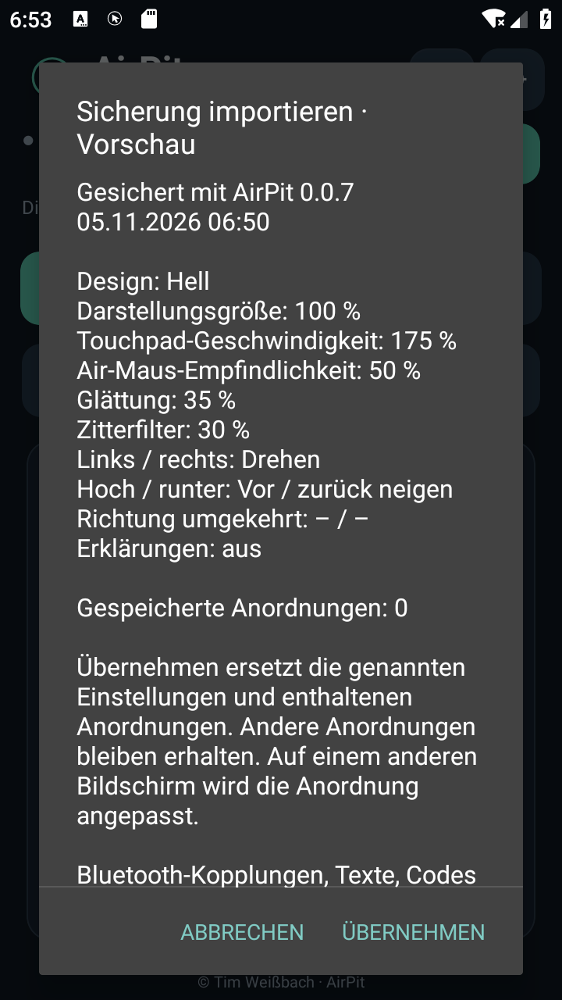

# AirPit · Anleitung

[README](../README.md) · [Download](https://github.com/Tim-Gurke/AirPit/releases/latest) · [Versionshistorie](VERSIONSHISTORIE.md)

## Installieren und aktualisieren

AirPit benötigt Android 9 oder neuer und ein Android-System mit Bluetooth-HID-Unterstützung. Für die Air-Maus muss ein Gyroskop vorhanden sein; das Touchpad kommt ohne diesen Sensor aus. Windows nimmt Maus und Tastatur per Bluetooth entgegen. WLAN, Konto und Root sind nicht erforderlich.

1. Die APK aus dem neuesten regulären Release herunterladen.
2. Beim ersten Installieren dem verwendeten Browser oder Dateimanager die Installation dieser APK erlauben.
3. APK öffnen und **Installieren** wählen. Bei einem Update **Aktualisieren** bestätigen; die vorhandene App zuvor nicht deinstallieren.
4. AirPit öffnen. App-Kennung und Updatesignatur bleiben gleich. Kopplungen, Einstellungen und gespeicherte Anordnungen bleiben bei einem regulären Update bestehen.

Die Sicherungsfunktion steht ab 0.0.7 zur Verfügung. Vor größeren Änderungen eine Sicherung anlegen. Nach einer Deinstallation gehen lokale App-Einstellungen verloren; die exportierte Datei an einem eigenen Speicherort aufbewahren. Android kann die Installation älterer Versionen über eine neuere ablehnen. Ein Rückweg über Deinstallation löscht die lokalen App-Daten; die Sicherungsdatei lässt sich ab einer kompatiblen Version wieder importieren.

## Mit Windows koppeln

1. Bluetooth auf Handy und PC einschalten.
2. In AirPit **Verbinden** antippen. Unter neueren Android-Versionen **Geräte in der Nähe** erlauben.
3. Unter **Verbindung → Für PC sichtbar · 2 Minuten** die Android-Sichtbarkeitsabfrage bestätigen.
4. Unter Windows **Bluetooth-Gerät hinzufügen** öffnen, das Handy auswählen und die Kopplung auf beiden Geräten bestätigen. Windows zeigt eventuell den normalen Bluetooth-Namen des Handys.
5. Den PC in AirPit auswählen. Beim nächsten Mal verbindet **Verbinden** den zuletzt verwendeten PC erneut.

Ein Sicherungsimport koppelt keinen neuen PC. Ein zweites Handy zuerst selbst mit Windows koppeln. Unter **Verbindung** lassen sich Bluetooth starten, die PC-Verbindung trennen und die Android-Bluetooth-Einstellungen öffnen.

## Touchpad und Maus

- Ein Finger bewegt den Zeiger; kurzes Tippen klickt links.
- Zwei Finger scrollen; kurzes Tippen mit zwei Fingern klickt rechts.
- **Linksklick** und **Rechtsklick** lassen sich gedrückt halten. **Ziehen** rastet die linke Maustaste ein; erneut antippen löst sie.
- **↑ Scrollen** und **↓ Scrollen** reagieren auch auf längeres Drücken.
- **Vollbild** bietet eine größere Touchpad-Fläche. Mit **← Zurück** zurückkehren.

Unter **Einstellungen → Touchpad-Geschwindigkeit** 25–300 % wählen. 100 % entspricht dem ursprünglichen Tempo; kleinere Werte bewegen genauer, größere schneller. **Touchpad auf 100 %** setzt den Wert zurück. Diese Einstellung gilt auch im Vollbild und in beiden Ausrichtungen. Sie verändert weder Zwei-Finger-Scrollen noch die Gyro-Empfindlichkeit.

## Air-Maus und Bewegungsachsen

Mit dem PC verbinden und **Air-Maus einschalten** wählen. Das Handy leicht drehen oder neigen. **Kalibrieren** antippen und etwa eine Sekunde stillhalten. Zum Neuansetzen **Umgreifen** gedrückt halten, Handy ausrichten und loslassen.

Unter **Einstellungen → Bewegungsachsen** für links/rechts und hoch/runter die gewünschte Bewegung wählen: **Drehen**, **Seitlich neigen / schwenken** oder **Vor / zurück neigen**. Seitlich neigen bedeutet, die linke oder rechte Handykante abzusenken. Beide Richtungen nutzen unterschiedliche Achsen; eine schon belegte Achse tauscht die Zuordnung. **Achsen tauschen** wechselt beide direkt. Richtungsumkehr, **Air-Maus-Empfindlichkeit**, **Glättung** und **Zitterfilter** sind separat einstellbar.

Bei fehlendem Sensor bleibt die Air-Maus deaktiviert. Die Steuerung pausiert normalerweise beim App-Wechsel; Bluetooth bleibt verbunden. **Bei Display aus weitersteuern** in den Einstellungen bewusst auf dem jeweiligen Handy aktivieren und gegebenenfalls Benachrichtigungen erlauben. Nur eine bereits gestartete Air-Maus darf dann bei ausgeschaltetem Display weiterlaufen. In der Benachrichtigung **Steuerung stoppen** oder **Beenden** wählen.

## Kacheln anordnen und ihre Größe ändern

1. Auf der gewünschten Seite **Anordnen** wählen. Die Steuerung am PC pausiert während der Bearbeitung.
2. Eine einzelne Fläche ziehen. Das sichtbare Raster hat 4 dp Abstand; die Position rastet ein. Bei zu wenig Platz rücken andere Flächen nach unten, auch über mehrere Reihen. Überlappungen werden verhindert.
3. Ein Element antippen, um **Links**, **Oben**, **Breite** und **Höhe** einzutragen. **Übernehmen** aktualisiert die Vorschau, speichert aber noch nicht die gesamte Anordnung.
4. Unter **Elemente** einzelne Flächen ein-/ausblenden. Unter **Vorlagen** eine Vorlage oder den Standard wählen. Über **Seite** auch andere Seiten und Vollbild bearbeiten; beim Drehen bleibt die Bearbeitung erhalten.
5. **Speichern & fertig** übernimmt alle Änderungen dieser Bearbeitung. **Änderungen verwerfen** stellt den vorher gespeicherten Stand wieder her.

Bei Zurück mit offenen Änderungen zwischen **Speichern**, **Verwerfen** und **Weiter bearbeiten** wählen. Für Hoch-/Querformat, Bedienung, Tastatur, Verbindung und Vollbild werden eigene Anordnungen gespeichert. Auch das Touchpad ist einzeln in Breite und Höhe veränderbar. Die globale **Darstellungsgröße** in den Einstellungen liegt bei 50–150 %; sie ersetzt die individuelle Größenwahl nicht.

## Sicherung exportieren und importieren

### Export

1. Offene Änderungen an der Anordnung mit **Speichern & fertig** abschließen oder verwerfen.
2. **Einstellungen → Sicherung exportieren** wählen.
3. Im Android-Dateidialog einen Speicherort wählen und die vorgeschlagene Datei `AirPit-Einstellungen-Datum-Uhrzeit.airpit` speichern.
4. Auf die Meldung **Sicherung exportiert** warten. Bei einem Schreibfehler erneut exportieren; eine unvollständige Datei nicht zum Wiederherstellen verwenden.

Die Datei enthält Design, Darstellungsgröße, Erklärungen, Touchpad-Geschwindigkeit, Gyro-Empfindlichkeit und Filter, Achsenzuordnung und Richtungsumkehr sowie alle dauerhaft gespeicherten Anordnungen mit Positionen, Größen und Sichtbarkeit. Noch nie individuell gespeicherte Seiten verwenden weiterhin die zum Bildschirm passenden Standardanordnungen.

Bluetooth-Kopplungen, PC-Adressen und Verbindungs-/Benachrichtigungsfreigaben sind gerätebezogen. Sie werden ebenso wie Codes und Textentwürfe nicht exportiert. Auch die Display-aus-Freigabe muss auf jedem Handy separat eingestellt werden. Die Datei enthält keine Signierschlüssel. Sie kann über einen selbst gewählten Dateidienst auf ein anderes Handy übertragen werden.

### Import

Aufnahme aus dem Android-9-Emulator mit einer Testdatei: Die Vorschau zeigt die vorgesehenen Werte, während die bisherige Oberfläche bis zur Übernahme bestehen bleibt.

1. Auf dem Zielhandy AirPit 0.0.7 oder eine kompatible neuere Version öffnen.
2. **Einstellungen → Sicherung importieren** wählen und die `.airpit`-Datei suchen.
3. Die Vorschau prüfen: Herkunftsversion, Sicherungszeit, alle Einstellungen und die enthaltenen Anordnungen werden aufgelistet.
4. **Abbrechen** schließt die Vorschau ohne Übernahme. **Übernehmen** speichert die enthaltenen Einstellungen und Anordnungen gemeinsam und aktualisiert die Oberfläche. Die Maussteuerung pausiert dabei.

Enthaltene Anordnungen ersetzen genau die entsprechenden Seiten und Ausrichtungen. Andere vorhandene Anordnungen bleiben erhalten. Auf anderen Bildschirmgrößen werden Positionen und Breiten angepasst und bei Bedarf Überschneidungen wie beim normalen Öffnen aufgelöst. Deshalb kann die Darstellung auf einem anderen Gerät abweichen. Die lokale PC-Kopplung und die lokalen Freigaben bleiben erhalten.

Fehlerhafte, unvollständige, zu große oder nicht unterstützte Sicherungen werden vor der Übernahme abgewiesen. Dateien anderer Pit-Apps sind nicht kompatibel. Die Dateiauswahl benötigt keine allgemeine Speicherberechtigung. Bei einem Speicherfehler den Vorgang wiederholen oder Speicherplatz freigeben. Vor einem gewollten Überschreiben des aktuellen Stands kann eine zusätzliche Exportdatei den Rückweg sichern.

## Tastatur, Texte und Emojis

Auf **Tastatur** mit Gboard oder einer anderen Bildschirmtastatur schreiben, korrigieren oder diktieren und **Text an PC senden** wählen. Erfolgreich gesendeter Text wird geleert; bei Fehler oder **Abbrechen** bleibt der Entwurf erhalten. **Text zurückholen** holt den letzten erfolgreichen Text aus dem Arbeitsspeicher zurück. Er wird weder dauerhaft protokolliert noch exportiert. Höchstens 1.000 Unicode-Codepunkte pro Sendung.

Für den normalen Tastaturmodus am PC **Deutsch (Deutschland)** wählen und Feststelltaste ausschalten. Direkttasten senden unter anderem Enter, Esc, Tab, Pfeile, Markieren, Kopieren, Einfügen, Rückgängig, Alt+Tab und Desktop. Kopieren/Einfügen verwendet die PC-Zwischenablage. Nach einem Abbruch den bereits am PC angekommenen Text prüfen; AirPit wiederholt die Sendung nicht automatisch.

**Windows-Emojis** öffnet die Windows-Auswahl mit Win+Punkt. Für direkt mit Gboard gesendete Emojis den optionalen [Windows-Helfer](https://github.com/Tim-Gurke/AirPit/releases/latest) vollständig entpacken und starten. DLL und Konfigurationsdatei daneben lassen. Unter **Verbindung → Emoji-Erweiterung verbinden** den sechsstelligen Helfercode eingeben und am PC das gewünschte Textfeld aktivieren. Der Helfer benötigt Windows-Bluetooth und .NET Framework 4.8. Darstellung und Unterstützung zusammengesetzter Emojis hängen vom Zielprogramm ab.

## Diagnose und Hilfe

**Einstellungen → Erklärungen anzeigen** blendet zusätzliche Hinweise ein. Unter **Diagnose ohne Textinhalte** stehen Betriebsereignisse und Fehler; die Diagnose lässt sich bei Bedarf kopieren. Sie enthält keine eingegebenen Texte oder Codes.

Wenn keine Verbindung entsteht, zuerst Bluetooth, Gerätefreigaben und die Windows-Kopplung prüfen; danach unter Verbindung Bluetooth erneut starten. Ein unbekannter Verbindungszustand bedeutet keine bestätigte Eingabe am PC. Die konkreten Bluetooth-Eigenschaften und das Verhalten bei ausgeschaltetem Display hängen auch von der Handy-ROM ab. [Prüfgrenzen dieser Version](qa/0.0.7.md).

© 2026 Tim Weißbach · AirPit
